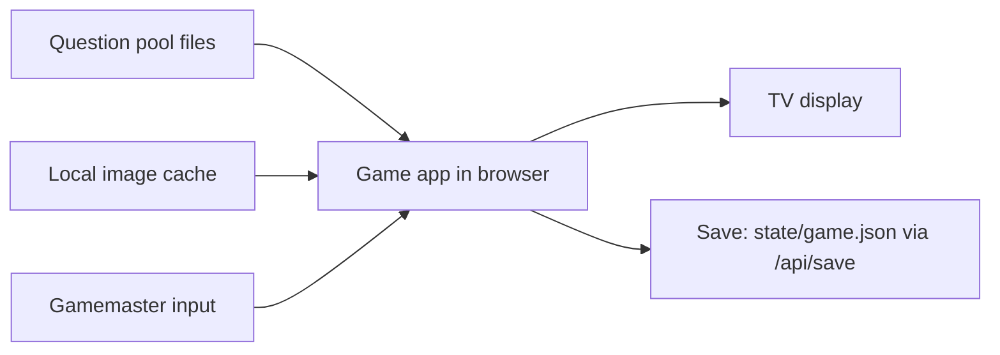

# 01 — Architecture

**Status:** implemented

## Approach (D-3, D-4, D-5, D-69, D-90; file layout: D-35, `19-repo-layout.md`)
A web app opened in a browser in fullscreen on the TV-connected machine, served by a **tiny local server** (agreed, D-3). The game engine (referee, selection, jokers, undo) runs in the browser (`app/client/src/engine/`, D-69, plan 12). The Python server (D-4) serves only static files (the built client, `app/data/` at `/data/`, cached media at `/media`) plus `GET/PUT /api/save`; the save is one JSON document, `state/game.json`, written whole by the client (D-67). No game logic and no network access in Python (D-90).

- Readable client build (plan 111, decision 124: Readable client build: output naming rule for mod overrides): Vite `preserveModules`, one unminified, unhashed file per source module, source maps, stable scoped class names; why: mods replace any module, component CSS or stylesheet by its path; `18-steam-integration.md` "Modding: module paths". Svelte's runtime as one `vendor/svelte.js` (decision 149, task 1025). Cost (task 1025, 2026-10-14, developer's PC, Xvfb, repo shell, fresh save, median of 20): launch → first screen 529 ms readable vs. 457 ms hashed (+0.07 s; page part 293 vs. 214 ms; 100 JS files vs. 3); with the per-file runtime 573 ms, page 345 ms (task 948: +0.14 s); `npm run build:optimized -w app/client` (Vite defaults: hashed, minified, no mods' by-path overrides) builds the hashed variant into `dist/` for such comparisons, never shipped.
- Mod overlay (desktop only, plan 112): the Electron shell's `app://` resolver serves enabled mods' folders before our client and data, first hit wins; `18-steam-integration.md` "Modding".

## Decisions needed
- ~~Frontend~~ Svelte 5 + Vite + TypeScript, built to static files served by the Python server (D-5).
- ~~Persistence: JSON file through a small local server vs. browser localStorage vs. a git-tracked file.~~ Local server agreed (D-3). Storage: ~~SQLite for state~~ (since PORT-8 a JSON save, `state/game.json`, D-67, D-90), a JSON file for questions (D-4).
- ~~Server language~~ Python (D-4).
- ~~One screen vs. two (a TV view plus a separate gamemaster view).~~ One screen, no GM view (D-30).

## Tasks
- [x] ARC-1 Choose the tech stack and record it in `decisions.md` and `AGENTS.md`. *2026-10-06: D-3, D-4, D-5.*
- [x] ARC-2 Define the project folder layout. *2026-10-06, `server/`, `client/`, `data/`, `tools/`; replaced 2026-10-07 by `app/` and `authoring/` (D-35, `19-repo-layout.md`).*
- [x] ARC-3 Scaffold the project with run/test commands. *2026-10-06, see `AGENTS.md`.*
- [x] ARC-4 Game engine in the browser, server = static files + `/api/save` (milestone 2, plan 12). *2026-10-12: D-69, D-90.*
