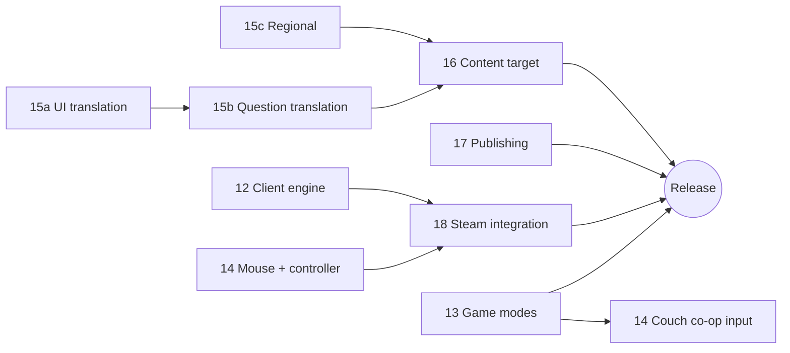

# 11 — Steam Release (Master Plan)

**Status:** draft

Turns «¡Trivia!» from a private living-room game (D-2) into a game anyone can buy and install from Steam (D-34). This file is only the map: the goal, the guiding principles, the tracks, their order and the questions that block them. Each track has its own sub-plan, which owns the details and the tasks.

*2026-10-07: the groundwork that can be done now and isn't Steam-specific (the TypeScript engine, mouse support, the joker budget, UI string extraction, region tags, the media license audit) has moved to [`project.md`](project.md) as milestones M7–M10. This plan keeps only what a public release needs on top of that.*

## Goal
A family can install the game from Steam on Windows, Linux or the Steam Deck. They can play it offline in a language they speak, without a gamemaster who knows the code, with a mouse, keyboard or controller, and with enough questions for many evenings. The current game (`trivia`, Python server + browser) keeps working until the Steam build replaces it; there is no separate family version (D-59).

## Principles
1. **The current game keeps working until the Steam build replaces it.** A change lands in it only when it doesn't make game night worse. Changes that don't change how the game plays (the TypeScript port, mouse support, string extraction) can land right away.
2. **One codebase, several modes.** The current way of playing stays as a mode (the gamemaster mode, [13](13-game-modes.md)). The other modes (D-74) are added next to it and don't replace it.
3. **Offline, no accounts, no telemetry.** Steam distributes the game and syncs saves. The game itself never phones home (AGENTS.md).
4. **Authoring stays in Python.** `qgen.py`, `media.py`, the review tool and the stats pages are authoring tools and don't ship. Only the game moves to TypeScript ([12](12-client-engine.md)).
5. **Minimal dependencies.** Shipping adds a desktop shell and a Steamworks binding ([18](18-steam-integration.md)). Every other dependency needs a decision.

## Tracks

| # | Sub-plan | What it covers | Changes the current game? | Groundwork in `project.md` | Steam part starts |
|---|----------|----------------|---------------------------|----------------------------|-------------------|
| 12 | [Client engine](12-client-engine.md) | Move the game referee from Python (`app/server/game.py`, `app/server/selection.py`) to TypeScript; storage adapters; pool export (done 2026-10-12: `app/client/src/engine/`, D-90) | No (same rules, same saves) | all of it (M7) | — |
| 13 | [Game modes](13-game-modes.md) | Five modes (D-74): gamemaster, «Solo o en grupo», round-robin co-op, round-robin competitive, competitive timed | Only if the family opts in | joker budget MD-1..MD-4 (M8) | S2 (OQ-30, OQ-36 answered) |
| 14 | [Input](14-input.md) | Every button clickable, controller support, couch co-op input | No | mouse IN-1 (M8) | S3 (controller) |
| 15 | [Internationalization](15-i18n.md) | Locale model; sub-plans [15a UI](15a-ui-translation.md), [15b questions](15b-question-translation.md), [15c regional](15c-regional-questions.md) | No | LUI-1..LUI-3, RG-1, RG-2 (M9) | launch languages es, en, de (D-78) |
| 16 | [Content target](16-content-target.md) | How many questions a release needs, how that is measured, the quality bar | No (more questions help the family too) | — | target set (D-75) |
| 17 | [Publishing](17-publishing.md) | Media and code licenses, credits, AI disclosure, store page, Steamworks account, rating | Credits screen only | audit PUB-1..PUB-3 (M10) | S2 (license), S5 (store) |
| 18 | [Steam integration](18-steam-integration.md) | Desktop shell, Steamworks (overlay, Cloud, achievements), builds, depots, Steam Deck | No | — | after M7 and OQ-29 |



## Phases

| Phase | Content | Tasks (start with) | Exit |
|-------|---------|--------------------|------|
| **S1 — Groundwork** | Moved to [`project.md`](project.md): M7 (TS engine), M8 (mouse, joker budget), M9 (UI strings, region tags), M10 (license audit) | — | M7–M10 done |
| **S2 — Product definition** | Answer the open questions below. Define the game modes and the launch languages. | MD-5..MD-7, I18N-1, CT-1, PUB-4 | OQ-29..OQ-37 resolved in `decisions.md` |
| **S3 — Playable desktop build** | Electron shell, file saves, controller support, Deck layout, credits screen | SW-1..SW-5, IN-2..IN-5, PUB-5 | A local build runs on Windows, Linux and the Deck with a controller only |
| **S4 — Content for release** | Translated UI and questions, regional packs, reaching the content target | QT-*, RG-3..RG-5, LUI-4..LUI-6, CT-* | Every launch language (es, en, de) has 5000 approved with D-53's mix (D-75); `qgen report --simulate` reports games per player |
| **S5 — Steam** | Steamworks app, Cloud, achievements, depots, beta branch, store page, disclosures | SW-6..SW-14, PUB-6..PUB-11 | Beta branch installed from Steam on a second machine and played by the family |
| **S6 — Release** | Coming-soon page, wishlists, release, patches | ST-3..ST-5 | Released; content updates go out as patches |
| **Later** | Competitive mode (8+ players), couch co-op, more regions and languages | MD-8+, IN-6+ | — |

S2 is decisions and can start now, alongside M7–M10. S3 needs M7 (the shell loads the client without Python). S3 ends with a developer platform test (Windows, Linux, Deck; controller only; offline): pm plan 48.

## Open questions (blocking)
Logged in [`open-questions.md`](open-questions.md) (frozen 2026-10-12; questions still open there are raised as `pm` decisions by their plans):

| ID | Question | Blocks |
|----|----------|--------|
| OQ-29 | ~~Desktop shell~~ answered: Electron (D-63) | 18 |
| OQ-30 | ~~Default mode~~ answered: five modes, no presets, no checkpoint, no skip outside gamemaster mode (D-74) | 13 |
| OQ-31 | ~~Launch languages~~ answered: es, en, de (zh-Hans, ru, pt-BR later); `base` in es-419 + es-ES variant, `colombia` stays Colombian (D-78) | 15, 16 |
| OQ-32 | ~~Content target~~ answered: 5000 approved per launch language, D-53's mix; no games number (D-75) | 16 |
| OQ-33 | Price model (paid, free, free + paid packs) and who holds the Steamworks account (person or company, tax) | 17 |
| OQ-34 | ~~Store name~~ answered: «Living Room Trivia» / «Trivia en Familia», pending PUB-7 (D-50) | 17 |
| OQ-35 | Code and content license; does the question pool stay public on GitHub? | 17 |
| OQ-36 | ~~Audience~~ answered: four age groups on one shared scale (D-38) | 13, 16 |
| OQ-37 | ~~Competitive and couch co-op~~ answered: round-robin co-op, round-robin competitive, competitive (timed); per-player gamepads + shared keyboard, no phones (D-77; timed revised D-80) | 13, 14 |

## Risks
- **Content volume and factual errors** are the most likely reason for bad reviews. A wrong answer in a public product costs more than at home. See 16 (quality bar) and 13 (a "report this question" action instead of the gamemaster's «Saltar y quemar para todos»).
- **Media licensing:** ~290 Commons files under nine license types. ShareAlike, PD-US-only and GFDL need care in a worldwide commercial release (17).
- **Install size:** the media cache is ~720 MB today and grows with the pool. It needs resizing and re-encoding before shipping (SW-9).
- **Engine port regressions:** the referee has subtle supply and matching rules. 12 builds fixtures from the Python engine before the port.
- **Scope creep:** competitive mode and couch co-op are explicitly "Later". The release doesn't wait for them.

## Release checklist (ST-4)
Every public build — the launch and every later patch — passes one checklist before its build goes from `beta` to `default`: the automated `trivia-release-check` (plan 18 "Builds and depots", SW-6) plus the manual rows below, which the developer runs on the Steam-installed `beta` build. Each release candidate gets one pm decision with the result (template below); parts 4 (launch, task 269) and 6 (patches, task 270) create it, nothing else does.

### How to run
- Bump `version` in `app/desktop/package.json` if needed, commit, `git tag v<x>` (the check never tags).
- `trivia-steam upload --branch beta`: runs `trivia-release-check` (tag gate, per-commit checks, licences, release bar, `nix build .#app`, desktop builds, credits both ways, smoke game), then stages and uploads; prints the BuildID.
- Manual rows need the `beta` build, so at upload time answer the prompt with a note (e.g. `later`: counts as skipped, named in the build Desc).
- Then the developer runs the rows below on `beta` and answers the candidate decision; `trivia-release-check --manual FILE` (one `<row>: <answer>` per line; `y…` passes, `n…` fails, anything else = note, counts as skipped) records the answers in the report.
- Report: `work/steam/v<x>/release-check.md` (header: version, pool hash, previous tag, kind, save version change; every skip).

### Manual rows
On the `beta` branch, installed through Steam. Scope: always, full (full release only), save (only when `SAVE_VERSION` changed since the previous tag).

| row | scope | steps |
|---|---|---|
| `offline` | always | Network off, Steam not running, start the installed game: full release: a full game to level 12 or a won checkpoint; content-only patch: a game to level 3 that hits new questions |
| `windows` | full | Clean Windows machine (no dev tools), install from Steam `beta`, start: no warning, game fullscreen, a few questions with a pad |
| `deck` | full | Best effort (decision 125): `no Deck (decision 125)` passes until the developer has a Deck; then plan 90's (SW-12) Deck checklist on the real Deck: `plans/18-steam-integration.md` "Steam Deck Verified" (until plan 90 writes it there: pm plan 90) |
| `cloud` | full | Short A→B run of plan 87's table (`plans/18-steam-integration.md` "Steam Cloud test", first row): play on A, quit, B shows the same players and seen counts |
| `sound` | full | Music, effects, an audio and a video question play |
| `red-frame` | full | Timed competitive: the red frame pulses in the last 3 s |
| `beta-save` | save | Save version changed: testers stay on `beta` until this build is on `default` (an older build can't read the new save) |
| `signoff` | always | Launch and full release: the family plays the candidate from `beta`; content-only patch: the developer's OK |

### Patch variant
- Kind, set by the check: `content-only` when, since the newest earlier `v*` tag, `git diff --name-only` touches nothing that ships except `app/data/` (shipped = `app/`, `flake.nix`, `flake.lock`, root `package*.json`); else `full`. No earlier tag = full.
- Why: a content-only patch changes no code, so platform behaviour (Windows/Deck start, Cloud, sound, red frame) can't change; what it can break (questions, media, licences, credits, pool loading) stays covered by every automated step plus `offline` and `signoff`.
- Full-only rows are answered "skipped: content-only since <tag>" automatically and listed in the report.

### Decision per release candidate
- Subject: `Release candidate v<x> passed?`
- Body: tag `v<x>`, BuildID, report path `work/steam/v<x>/release-check.md`, kind, then the rows table to fill:

  | row | result ✓/✗/n/a | note (✗: how to reproduce) |
  |---|---|---|
  | offline | | |
  | … every row the report lists, auto-skipped ones pre-filled | | |

- Options: `passed` (recommended), `passed with minor issues (list)`, `failed (rows)`.
- Worker on the answer:
  - `passed`: `trivia-release-check --manual FILE` with the answers so the report holds them; the build may go to `default` (by hand, Steamworks).
  - `passed with minor issues`: as passed; each issue a bullet in `plans/backlog.md`.
  - `failed`: one task per failing row in the owning plan (Deck → plan 90/18, Cloud → plan 87/18, sound, red frame, offline → the plan of the code involved); after the fixes a new tag and a new candidate decision.
- Review request for Deck Verified: plan 90 (task 687) decides whether it moves here.

## Coming soon page (ST-3)
The Steam store page goes public as "Coming soon" well before the release, so it collects wishlists and follows. The developer does every Steamworks step; this section holds Valve's rules (read 2026-10-13) and the checklist. The live date sets the earliest release date for part 4 (task 269).

### Valve's rules
- Minimum "Coming soon": new products ≥ 2 weeks public before release; no downside to a long lead ("two years ahead … just as likely to purchase"). Sources: partner.steamgames.com/doc/store/coming_soon, /doc/store/releasing (read 2026-10-13).
- First titles: also ≥ 21 days between paying the app fee and release. Source: /doc/gettingstarted/onboarding (read 2026-10-13).
- Earliest release = later of (live date + 14 days, app fee paid + 21 days); the build review (3–5 business days, plan ≥ 7) also has to be done.
- Store page review: typically 3–5 business days; submit ≥ 7 business days before the wanted live date. Fixes come back as feedback; otherwise the page is marked "Ready for release". Reviewed once, then free to update. Source: /doc/store/review_process (read 2026-10-13).
- What the review checks: only features and content available at launch (no `PLACEHOLDER` or planned features unless clearly marked); capsules show a readable title or logo; screenshots gameplay only (no concept art, awards, marketing text); description detailed, coherent, no links to other websites. Source: /doc/store/review_process.
- Prerequisites: app created with the app credit (Steam Direct fee $100, /doc/gettingstarted/appfee); everything in the "Your Store Presence" checklist on the app landing page (/doc/store/coming_soon); content survey complete before submitting for review, incl. AI disclosure "Pre-Generated" (/doc/gettingstarted/contentsurvey); required graphics: header 920×430, small 462×174, main 1232×706, vertical 748×896 capsules, screenshots ≥ 1920×1080 16:9, plus library assets (/doc/store/assets); Steamworks permissions "Publish app changes to Steam" and "Manage pricing and discounts" (/doc/store/releasing). All read 2026-10-13.
- Posting: after approval, the green "Post as Coming Soon" button; page goes public, Community Hub and wishlists start; at release Steam e-mails everyone who wishlisted. Source: /doc/store/coming_soon.
- Release date: an exact intended date is always set (hidden); the store shows one of five: exact date, month + year, quarter ("Q3 2023"), year, or none ("Coming Soon"); display switchable freely before release; less specific = listed at the end of the range, none = behind all dated games. The date itself can change until two weeks before it, then it's locked. Weekends hidden in the picker. Source: /doc/store/release_dates (read 2026-10-13).

### Developer checklist
In order; workers never log in, enter credentials or contact Valve (plan 94).
1. Prerequisites done:
   - Store page entered: `task 672: Store page entry checklist and PUB-8 close-out`'s decision answered "entered".
   - Names per D-50 set in Steamworks: «Living Room Trivia», localized «Trivia en Familia» (part 1 of masterplan 10, `task 253`; PUB-7 check passed).
   - Content survey complete, incl. AI disclosure (part 9 of masterplan 10, `task 259`; PUB-9).
   - App credit paid (PUB-6, `task 253`; decision 66 for person/company); note the payment date (21-day rule).
   - Steamworks "Your Store Presence" checklist all green.
2. Steamworks app landing page: "Mark as ready for review" for the store page, ≥ 7 business days before the wanted live date.
3. Wait for Valve's review (3–5 business days).
4. Fix what Valve returns, each fix where it belongs:
   - texts, capsules, screenshots, AI disclosure text: `plans/17a-store-page.md` (its texts, capsules and "Screenshots" sections), plan 88;
   - system requirements, languages, controller: `17a` "System requirements, languages, controller", plan 88;
   - content survey: part 9's plan (`task 259`);
   - names: part 1's plan (`task 253`).
5. Release date: exact intended date = a placeholder months out; display "Coming Soon" (no date) until part 4 fixes the date; a coarse "Q<n> <year>" is allowed once known.
6. "Post as Coming Soon".
7. Note the live date and the date shown; answer the pm decision "Coming soon page live? date?".
- Wishlists: only Steam's own wishlist and follow buttons; no mailing list, own website, social accounts or marketing.

## Launch (S6)
The release candidate `v1.0.0` goes from `beta` through the release checklist (ST-4), the family's sign-off and Valve's build review to `default`, and the developer presses Release on a date the "Coming soon" rules (ST-3) allow. Then a launch-day checklist and a first week of watching by hand. Every Steamworks step is the developer's; workers write the texts, raise the decisions and record the answers (pm plan 95).

### Valve's rules
2026-10-13, task 706: no web access for the worker (WebFetch/WebSearch denied); rules already read for ST-3 (same day) are reused, the rest is unverified. Valve's wording wins.
- Release date and lock: exact intended date set in Steamworks, changeable until two weeks before it, then locked; earliest release = later of (Coming soon live + 14 days, app fee paid + 21 days). Source: ST-3 "Valve's rules" above (/doc/store/release_dates, /doc/store/coming_soon, /doc/gettingstarted/onboarding, read 2026-10-13).
- Permissions for releasing: "Publish app changes to Steam" and "Manage pricing and discounts". Source: /doc/store/releasing (read 2026-10-13, ST-3).
- At release Steam e-mails everyone who wishlisted. Source: /doc/store/coming_soon (read 2026-10-13, ST-3).
- Community Hub: starts when the page is posted as Coming soon (/doc/store/coming_soon, read 2026-10-13, ST-3); whether the Discussions forum is open to players before release: unverified (developer: check the app's Community Hub after posting).
- Build review lead time: unverified (developer: check https://partner.steamgames.com/doc/store/review_process). ST-3 only verified the store page review (3–5 business days, submit ≥ 7 before); this plan assumes the same buffer for the build until confirmed.
- What the build review checks (starts, matches the store page, no placeholder content, which branch it reads): unverified (developer: check https://partner.steamgames.com/doc/store/review_process). Rule here anyway: no `PLACEHOLDER(` in the candidate (AGENTS.md; ST-3's store review rule).
- Setting a build live on `default`, the Release button and a scheduled release (time of day, whether it fires by itself): unverified (developer: check https://partner.steamgames.com/doc/store/releasing and https://partner.steamgames.com/doc/sdk/uploading).
- Launch discount (max %, duration, setup deadline, cooldown after it): unverified (developer: check https://partner.steamgames.com/doc/marketing/discounts); decision 66's draft noted a 30-day cooldown between discounts, also unverified.
- Announcements (event types, per-language texts, scheduling): unverified (developer: check https://partner.steamgames.com/doc/marketing/event_tools).

### Preconditions
All ✓ before the go decision (`Start the launch release candidate v1.0.0?`).
| precondition | how it's checked |
|---|---|
| Coming soon live; earliest release date known | ST-3 `[x]` above with live date and earliest release date (`task 704: Record the Coming soon result (ST-3)`, decision "Coming soon page live? date?") |
| Content target per launch language (decision 21, decision 37, D-75) | `qgen export && qgen report --simulate --locale es,en,de`: ✓ for every language, exit 0 (`app/data/pool.json`, `pool.en.json`, `pool.de.json` vs. `targets.json`; milestone 9 "Done when") |
| Beta test passed (masterplan 10 part 11) | `task 263: write plan: Beta test and S5 close-out`'s plan done, its "S5 beta test passed?" answered passed; S5 row done above |
| Price and account (decision 66, decision 67) | both answered; `task 194` done; PUB-11 in `plans/17-publishing.md` holds price, regional pricing, launch discount |
| Question reports (plan 93) | tasks 699, 700, 701 done: copy text + "where to send" in the build, `qgen flag`, thread texts per language in ST-5 |
| Deck review timing (plan 90) | `task 687` done: SW-12 `[x]` in `plans/18-steam-integration.md`; if it says "review in S6", the launch-day row below applies |
| Steamworks app ready | SW-7 `[x]` (App ID, depots, `beta` branch; decision 89); first `beta` upload recorded |
| No placeholders | `grep -rn 'PLACEHOLDER(' app/` empty |

### Timeline
Backwards from the release date R (a weekday ≥ the earliest release date):
- R − 2 weeks: exact date locks (ST-3); set R as the exact date and display it before then.
- R − ≥ 7 business days (until Valve's figure is verified): build submitted for review; so the candidate has passed ST-4 before.
- Before that: candidate on `beta`, manual rows and family sign-off (allow a weekend for the family game).
- Go decision answered → candidate built the same week.

### Release candidate steps
1. Go decision answered `go`.
2. `app/desktop/package.json` `version` → `1.0.0` (decision 91: Game version: single source of truth); commit.
3. `git tag v1.0.0` on that commit (the check never tags).
4. `trivia-steam upload --branch beta` (runs `trivia-release-check`; prints the BuildID; manual prompt: `later`).
5. Manual rows on the Steam-installed `beta` ("Manual rows" above), full release: all of them.
6. Family sign-off: a family game from `beta` (row `signoff`).
7. Candidate decision `Release candidate v1.0.0 passed?` per "Decision per release candidate"; answers recorded with `trivia-release-check --manual FILE`.
- Failed: fixes → `1.0.1`, new tag, new candidate decision; a tag is never reused.

### Launch-day checklist
In order, Steamworks (partner.steamgames.com, the app's landing page); menu names as known 2026-10, Valve's UI wins.
| row | steps |
|---|---|
| Build review passed | App landing page: build review status passed for the candidate's BuildID; issues → answer "Released?" with `Valve's build review returned issues` |
| Candidate live on `default` | SteamPipe → Builds → the passed candidate's BuildID (Desc `v1.0.x <sha>`) → "Set build live on branch" `default` → Preview → Set live; never from the repo (decision 84: SteamCMD source and depot split). Check: `default` and `beta` show the same BuildID |
| Price | Store & release / Pricing: base price and regional prices per PUB-11 (`plans/17-publishing.md`, decision 66) |
| Launch discount (if PUB-11 has one) | Marketing & Visibility → Discounting → launch discount scheduled for R, % and length per PUB-11 and Valve's rules (unverified above) |
| Store languages = shipped | Store page → Supported languages: tick exactly what the build ships (see "Languages to compare") |
| Discussions and report thread | Community Hub → Discussions: open; one thread per language with ST-5's text (`task 701`), each pinned ("Make sticky") |
| Deck review | Only if SW-12 says "review in S6" (plan 90): app → Steam Deck Compatibility → request review; result → plan 18 |
| Release | App landing page → Release: press Release on R (or check the scheduled release fired); store page shows the game buyable |
| Announcement | Community → Events & Announcements → new event, type release/launch, texts per language from "Announcement texts" (plan 95 task 2) |

### Languages to compare
- Store (`plans/17a-store-page.md` "Supported languages", decision 26, decision 27): English, Spanish – Latin America, Spanish – Spain, German; interface ✓, subtitles ✓, audio ✗.
- Shipped UI catalogs (`app/client/src/locales/`, `UI_LANGS`): `es`, `es-ES`, `en`, `de` (`xx` dev only).
- Shipped question pools (`app/data/`): `pool.json` (es); `pool.en.json`, `pool.de.json` missing on 2026-10-13. A language without its pool can't be ticked as a launch language (precondition "content target").

### Announcement texts
Per language, written by plan 95 task 2 (`task 707`, 2026-10-13); posted by the developer on launch day (Community → Events & Announcements, one text per Steam language). Workers never post.
- Placeholders: `<n_es>`, `<n_en>`, `<n_de>` = questions per language from `qgen report` (filled by `task 708: Release candidate v1.0.0`); `<thread>` = the pinned report thread's title per language (ST-5, `task 701`; decision 93 pending: if it picks e-mail over a thread, the report paragraph changes with it).
- Facts as of 2026-10-13: launch modes = gamemaster mode and «Solo o en grupo» (plan 13; multiplayer later, milestone 11 out of scope); names per D-50 (German: no localized name); UI words from `app/client/src/locales/`; AI wording from `plans/17-publishing.md` "AI disclosure" (`17a` has no AI text yet: if PUB-9's final text differs, follow it).
- No marketing claims, no links outside Steam. Body in Steam's BBCode. Forum name («Discusiones», "Diskussionen"): use Steam's own label in that language.
- Spanish: Spanish – Latin America gets es-419 as written; Spanish – Spain the same text with the es-ES deltas applied.

#### English
- Title: `Living Room Trivia is out now`
- What's new (1.0.0): `First release: gamemaster mode and «Alone or as group», questions in Spanish, English and German.`
- Body:
```
Living Room Trivia is a trivia game for the TV: the family plays together as one team, and 12 right answers in a row win the game. A wrong answer ends it.

Two modes:
[list]
[*]Gamemaster mode: one person runs the game for the others: difficulty, number of levels, jokers, video and audio questions; they can skip, replace or undo a question.
[*]Alone or as group: one player, or everyone as one team, without a gamemaster; pick an age group and play with the standard jokers.
[/list]
Five jokers; questions with images, audio and video. Gamepad, keyboard or mouse. Runs offline; no account needed.

Languages (interface and questions):
[list]
[*]Spanish (Latin America and Spain): <n_es> questions
[*]English: <n_en> questions
[*]German: <n_de> questions
[/list]

Questions, hints and translations were drafted with AI (Claude), fact-checked with web search and reviewed by a person or by a second AI check before they went into the game. Images and sounds are by people and listed in the game's Credits (menu, Esc). Nothing is generated while you play.

A wrong or unclear question? Mark it in the game (flag icon or M), open "Marked questions" in the menu (Esc), press "Copy" and paste the text into the pinned thread "<thread>" in this game's Discussions. No account details needed.
```

#### Spanish (es-419)
- Title: `Trivia en Familia ya está disponible`
- What's new (1.0.0): `Primera versión: Modo anfitrión y «Solo o en grupo», preguntas en español, inglés y alemán.`
- Body:
```
Trivia en Familia es un juego de preguntas para el televisor: la familia juega unida, como un solo equipo, y 12 respuestas correctas seguidas ganan la partida. Una respuesta incorrecta la termina.

Dos modos:
[list]
[*]Modo anfitrión: una persona maneja la partida para los demás: dificultad, número de niveles, comodines, preguntas con video y audio; puede saltar, cambiar o deshacer una pregunta.
[*]Solo o en grupo: una persona sola, o todos como un equipo, sin anfitrión; se elige el grupo de edad y se juega con los comodines estándar.
[/list]
Cinco comodines; preguntas con imágenes, audio y video. Control, teclado o mouse. Funciona sin internet; no hace falta cuenta.

Idiomas (interfaz y preguntas):
[list]
[*]Español (Latinoamérica y España): <n_es> preguntas
[*]Inglés: <n_en> preguntas
[*]Alemán: <n_de> preguntas
[/list]

Las preguntas, las pistas y las traducciones se redactaron con IA (Claude), se verificaron con búsquedas en la web y las revisó una persona o una segunda revisión con IA antes de entrar al juego. Las imágenes y los sonidos son obra de personas y figuran en los créditos del juego (menú, Esc). Nada se genera mientras juegan.

¿Una pregunta incorrecta o confusa? Márquenla en el juego (icono de bandera o M), abran «Preguntas marcadas» en el menú (Esc), presionen «Copiar» y peguen el texto en el hilo fijado «<thread>» de las Discusiones de este juego. No hace falta ningún dato de la cuenta.
```

#### Spanish (es-ES deltas)
Same title, what's new and body, with:
- `video` → `vídeo` (both places)
- `Control, teclado o mouse` → `Mando, teclado o ratón`
- `mientras juegan` → `mientras jugáis`
- `Márquenla` → `Marcadla`, `abran` → `abrid`, `presionen` → `pulsad`, `peguen` → `pegad`

#### German
- Title: `Living Room Trivia ist erschienen`
- What's new (1.0.0): `Erste Version: „Mit Spielleitung“ und „Allein oder in der Gruppe“, Fragen auf Spanisch, Englisch und Deutsch.`
- Body:
```
Living Room Trivia ist ein Quizspiel für den Fernseher: Die Familie spielt zusammen als ein Team, und 12 richtige Antworten in Folge gewinnen das Spiel. Eine falsche Antwort beendet es.

Zwei Modi:
[list]
[*]Mit Spielleitung: Eine Person leitet das Spiel für die anderen: Schwierigkeit, Anzahl der Stufen, Joker, Video- und Audiofragen; sie kann eine Frage überspringen, austauschen oder zurücknehmen.
[*]Allein oder in der Gruppe: eine Person allein oder alle als ein Team, ohne Spielleitung; Altersgruppe wählen und mit den Standard-Jokern spielen.
[/list]
Fünf Joker; Fragen mit Bildern, Audio und Video. Gamepad, Tastatur oder Maus. Läuft offline; kein Konto nötig.

Sprachen (Oberfläche und Fragen):
[list]
[*]Spanisch (Lateinamerika und Spanien): <n_es> Fragen
[*]Englisch: <n_en> Fragen
[*]Deutsch: <n_de> Fragen
[/list]

Fragen, Hinweise und Übersetzungen wurden mit KI (Claude) entworfen und per Websuche auf Fakten geprüft; vor der Aufnahme ins Spiel hat sie ein Mensch oder eine zweite KI-Prüfung durchgesehen. Bilder und Klänge stammen von Menschen und stehen im Spiel unter „Mitwirkende“ (Menü, Esc). Beim Spielen wird nichts generiert.

Eine Frage ist falsch oder unklar? Markiert sie im Spiel (Fahnen-Symbol oder M), öffnet „Markierte Fragen“ im Menü (Esc), drückt „Kopieren“ und fügt den Text in den angehefteten Thread „<thread>“ in den Diskussionen dieses Spiels ein. Kontodaten sind nicht nötig.
```

### First week
- Developer daily: Community Hub discussions (every report thread) and the store reviews.
- To pm:
  - question reports: paste the text into `qgen flag` (plan 93), or into a pm task if unsure;
  - bugs: steps to reproduce, version and pool hash from the credits screen, platform (Windows, Linux, Deck);
  - review themes: one line each.
- Each bug → a task in its owning plan or a `plans/backlog.md` row.
- Hotfix (wrong answer, crash): version bump (`1.0.1`), commit, new tag, ST-4 checklist (content-only if only `app/data/` changed), `beta`, then `default`; patch flow = `task 270: write plan: Content updates as patches (ST-5)`'s plan.
- Result via decision "First week after launch: what came in?" (plan 95 task 5).

## Privacy (ST-5)
Texts for question reports sent to the report server (plan 103, written by task 867 on 2026-10-13 from plan 103's API contract, "Data" and "Retention"; the Worker wasn't built yet: task 865/866 must keep to it or edit these texts). The long version is the public `PRIVACY.md` at the repo root; the store text and the in-game dialog text are short versions of it. Telemetry (milestone 14) adds its own section later (plan 108).

### Where it goes on Steam
- Valve's public Steamworks docs name no privacy-policy field (checked 2026-10-13: the `partner.steamgames.com/doc` store, onboarding and marketing pages; "privacy policy" appears only as Steam's own policy in the Rules & Guidelines).
- Steps for the developer (before the build with «Enviar» goes to `default`):
  - Steamworks → app → Edit Store Page: look for a privacy-policy or EULA/legal field (tabs "Basic Info", "Special Configuration"); if one takes a URL: `https://github.com/rubenmoor/trivia/blob/main/PRIVACY.md`
  - in any case: Edit Store Page → "Description" → "About This Game", per language (English, Spanish – Latin America, Spanish – Spain, German): append the store text below as the last paragraph (heading in Steam's BBCode `[h2]`)
  - Preview, then Publish; the store review sees it with the next change
- Plan 95's launch-day checklist checks it is on the page in every store language.
- A full EU privacy notice may need the controller's name and contact; `PRIVACY.md` names the game's Steam Discussions as contact. Add an address there if the developer wants one.

### Store text
English:
```
[h2]Privacy[/h2]
The game runs offline. Only if you press "Send" on a marked question does it send a report: question id and language, the question as shown, your note, game and pool version, and a one-time Steam ticket that proves a real copy. Kept: those fields, without Steam account id, IP address or name, until the developer downloads them, at most 90 days. Cloudflare hosts the server, Valve checks the ticket. No analytics, no ads. Full text: PRIVACY.md in the game's repository.
```
Spanish (es-419 and es-ES, no deltas):
```
[h2]Privacidad[/h2]
El juego funciona sin internet. Solo al presionar «Enviar» en una pregunta marcada envía un reporte: id e idioma de la pregunta, la pregunta tal como se vio, la nota, versión del juego y del banco de preguntas, y un ticket de Steam de un solo uso que demuestra una copia real. Se guardan esos datos, sin id de la cuenta de Steam, sin dirección IP ni nombre, hasta que el desarrollador los descarga, como máximo 90 días. Cloudflare aloja el servidor y Valve verifica el ticket. Sin analítica ni publicidad. Texto completo: PRIVACY.md en el repositorio del juego.
```
German:
```
[h2]Datenschutz[/h2]
Das Spiel läuft offline. Nur bei „Senden“ an einer markierten Frage geht eine Meldung hinaus: ID und Sprache der Frage, die Frage wie angezeigt, die Notiz, Spiel- und Poolversion sowie ein einmaliges Steam-Ticket als Nachweis einer echten Kopie. Gespeichert werden diese Angaben ohne Steam-Konto-ID, IP-Adresse oder Namen, bis der Entwickler sie abruft, höchstens 90 Tage. Cloudflare betreibt den Server, Valve prüft das Ticket. Keine Analyse, keine Werbung. Volltext: PRIVACY.md im Repository des Spiels.
```

### Dialog text (plan 93's send confirmation)
- Impersonal, so `es` and `es-ES` share one text (no `es-ES` key).
- es: «Se envían la pregunta tal como se vio, la nota, el idioma y la versión del juego, con un ticket de Steam de un solo uso.» / «No se guarda la cuenta de Steam ni la IP; se borra al descargarse, a más tardar en 90 días.»
- en: "Sends the question as shown, the note, its language and the game version, with a one-time Steam ticket." / "No Steam account or IP is kept; deleted once downloaded, after 90 days at most."
- de: „Gesendet werden die Frage wie angezeigt, die Notiz, die Sprache und die Spielversion, dazu ein einmaliges Steam-Ticket.“ / „Steam-Konto und IP werden nicht gespeichert; gelöscht nach dem Abruf, spätestens nach 90 Tagen.“

## Tasks
- [ ] ST-1 Resolve OQ-29..OQ-37 and record each answer in `decisions.md` (phase S2).
- [x] ST-2 Add the new files to `README.md`, the Steam track to `project.md`, the questions to `open-questions.md` and D-34. *2026-10-07: done with this plan; keep `project.md` in sync from now on.*
- [ ] ST-3 Steam "Coming soon" page live (after PUB-8, SW-7). *Plan: pm plan 94 (checklist with Valve's cited rules, pm decision "Coming soon page live? date?").*
- [x] ST-4 Release checklist: build from a tagged commit, `qgen.py validate` clean, credits complete, offline test, Deck test, family sign-off. *Done 2026-10-13 (pm plan 92): "Release checklist (ST-4)" above; `trivia-release-check` tag gate, kind full/content-only, credits both ways, manual rows. First full run: part 4's release candidate (task 269).*
  - S6 part 2 done 2026-10-13 (pm plan 91: Version numbers and patch-safe saves; no ST-row of its own): one version in `app/desktop/package.json`, pool hash, both on the credits screen; running games survive dropped questions; `qgen validate` guards id continuity against the newest `v*` tag (`18`, `12`).
- [ ] ST-5 Post-release: content update cadence, how question reports are collected.
  - [x] Reports half done 2026-10-13 (pm plan 93, decision 93): «Enviar» / «Enviar todas» in «Preguntas marcadas» → shell main posts to plan 103's `POST /reports` with a Steam ticket (`report:*` IPC, `app/desktop/report.mjs`); copy per flag and all as fallback (text format decision 142); `qgen flag` (pasted text) and `qgen flag --pull` (server, ledger `state/reports-pulled.json`) → `needs_work`. URL: `reportUrl` in `app/desktop/package.json`, empty until plan 103's server is live (task 868): until then copy only.
  - [ ] Cadence half: pm plan 96.
  - Privacy texts done 2026-10-13 (task 867): `PRIVACY.md`, "Privacy (ST-5)" above (store text, dialog text, Steamworks steps).
  - Server half, part 1 done 2026-10-14 (task 865): `report-server/` (Cloudflare Workers + D1, plan 103 API v1): reports, pull/ack, `/health`, rate limits (vars `RATE_USER` 20, `RATE_TOTAL` 1000 per UTC day), kill switch `REPORTS_OPEN`, cron 03:00 UTC (past `rate` days, reports > 90 days); `trivia-report-server dev` with fake `dev-*` tickets; real Steam check: task 866. Free tier (plan 103's figures, not re-checked: no web access in task 865; task 868 checks them on Cloudflare's pricing pages at signup): Workers 100k requests/day, 10 ms CPU/request, cron included; D1 5 GB, 5M rows read and 100k rows written/day. Our load: ≈ 4 row writes per report.
  - Server half, part 2 done 2026-10-13 (task 866): real Steam check in `report-server/src/steam.ts`.
    - Source, checked 2026-10-13: partner.steamgames.com/doc/webapi/ISteamUserAuth (`GET https://partner.steam-api.com/ISteamUserAuth/AuthenticateUserTicket/v1/`, `key` publisher key, `appid`, `ticket` hex, `identity` = the string given to `GetAuthTicketForWebApi`; only tickets made with it pass) and /doc/features/auth "Backend Server Session Tickets" (partner host, publisher key). Plan 103's contract unchanged.
    - Response shape not on Valve's pages (they say only "returns the 64-bit SteamID"): built on the known `{"response": {"params": {"result": "OK", "steamid", "ownersteamid", "vacbanned", "publisherbanned"}}}` / `{"response": {"error": {"errorcode", "errordesc"}}}`; task 868's first real report confirms it.
    - `error`, result not `OK`, `publisherbanned` → 401; HTTP error, other JSON, timeout 5 s, network error → 502; `STEAM_WEB_API_KEY` or `STEAM_APP_ID` unset → 502 (half set-up fails safe). Key, ticket and SteamID never logged or returned.
