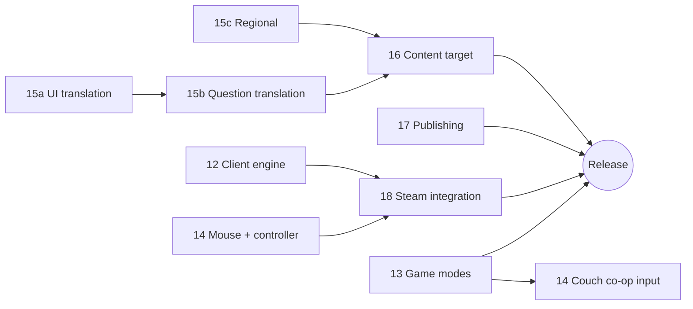

# 11 — Steam Release (Master Plan)

**Status:** draft

Turns «¡Trivia!» from a private living-room game (D-2) into a game anyone can buy and install from Steam (D-34). This file is only the map: the goal, the guiding principles, the tracks, their order and the questions that block them. Each track has its own sub-plan, which owns the details and the tasks.

*2026-10-07: the groundwork that can be done now and isn't Steam-specific (the TypeScript engine, mouse support, the joker budget, UI string extraction, region tags, the media license audit) has moved to [`project.md`](project.md) as milestones M7–M10. This plan keeps only what a public release needs on top of that.*

## Goal
A family can install the game from Steam on Windows, Linux or the Steam Deck. They can play it offline in a language they speak, without a gamemaster who knows the code, with a mouse, keyboard or controller, and with enough questions for many evenings. The current game (`trivia`, Python server + browser) keeps working until the Steam build replaces it; there is no separate family version (D-59).

## Principles
1. **The current game keeps working until the Steam build replaces it.** A change lands in it only when it doesn't make game night worse. Changes that don't change how the game plays (the TypeScript port, mouse support, string extraction) can land right away.
2. **One codebase, several modes.** The current way of playing stays as a mode (the gamemaster mode, [13](13-game-modes.md)). The other modes (D-74) are added next to it and don't replace it.
3. **Offline, no accounts, no telemetry.** Steam distributes the game and syncs saves. The game itself never phones home (AGENTS.md).
4. **Authoring stays in Python.** `qgen.py`, `media.py`, the review tool and the stats pages are authoring tools and don't ship. Only the game moves to TypeScript ([12](12-client-engine.md)).
5. **Minimal dependencies.** Shipping adds a desktop shell and a Steamworks binding ([18](18-steam-integration.md)). Every other dependency needs a decision.

## Tracks

| # | Sub-plan | What it covers | Changes the current game? | Groundwork in `project.md` | Steam part starts |
|---|----------|----------------|---------------------------|----------------------------|-------------------|
| 12 | [Client engine](12-client-engine.md) | Move the game referee from Python (`app/server/game.py`, `app/server/selection.py`) to TypeScript; storage adapters; pool export (done 2026-10-12: `app/client/src/engine/`, D-90) | No (same rules, same saves) | all of it (M7) | — |
| 13 | [Game modes](13-game-modes.md) | Five modes (D-74): gamemaster, «Solo o en grupo», round-robin co-op, round-robin competitive, competitive timed | Only if the family opts in | joker budget MD-1..MD-4 (M8) | S2 (OQ-30, OQ-36 answered) |
| 14 | [Input](14-input.md) | Every button clickable, controller support, couch co-op input | No | mouse IN-1 (M8) | S3 (controller) |
| 15 | [Internationalization](15-i18n.md) | Locale model; sub-plans [15a UI](15a-ui-translation.md), [15b questions](15b-question-translation.md), [15c regional](15c-regional-questions.md) | No | LUI-1..LUI-3, RG-1, RG-2 (M9) | launch languages es, en, de (D-78) |
| 16 | [Content target](16-content-target.md) | How many questions a release needs, how that is measured, the quality bar | No (more questions help the family too) | — | target set (D-75) |
| 17 | [Publishing](17-publishing.md) | Media and code licenses, credits, AI disclosure, store page, Steamworks account, rating | Credits screen only | audit PUB-1..PUB-3 (M10) | S2 (license), S5 (store) |
| 18 | [Steam integration](18-steam-integration.md) | Desktop shell, Steamworks (overlay, Cloud, achievements), builds, depots, Steam Deck | No | — | after M7 and OQ-29 |

## Phases

| Phase | Content | Tasks (start with) | Exit |
|-------|---------|--------------------|------|
| **S1 — Groundwork** | Moved to [`project.md`](project.md): M7 (TS engine), M8 (mouse, joker budget), M9 (UI strings, region tags), M10 (license audit) | — | M7–M10 done |
| **S2 — Product definition** | Answer the open questions below. Define the game modes and the launch languages. | MD-5..MD-7, I18N-1, CT-1, PUB-4 | OQ-29..OQ-37 resolved in `decisions.md` |
| **S3 — Playable desktop build** | Electron shell, file saves, controller support, Deck layout, credits screen | SW-1..SW-5, IN-2..IN-5, PUB-5 | A local build runs on Windows, Linux and the Deck with a controller only |
| **S4 — Content for release** | Translated UI and questions, regional packs, reaching the content target | QT-*, RG-3..RG-5, LUI-4..LUI-6, CT-* | Every launch language (es, en, de) has 5000 approved with D-53's mix (D-75); `qgen report --simulate` reports games per player |
| **S5 — Steam** | Steamworks app, Cloud, achievements, depots, beta branch, store page, disclosures | SW-6..SW-14, PUB-6..PUB-11 | Beta branch installed from Steam on a second machine and played by the family |
| **S6 — Release** | Coming-soon page, wishlists, release, patches | ST-3..ST-5 | Released; content updates go out as patches |
| **Later** | Competitive mode (8+ players), couch co-op, more regions and languages | MD-8+, IN-6+ | — |

S2 is decisions and can start now, alongside M7–M10. S3 needs M7 (the shell loads the client without Python). S3 ends with a gamemaster platform test (Windows, Linux, Deck; controller only; offline): pm plan 48.

## Open questions (blocking)
Logged in [`open-questions.md`](open-questions.md) (frozen 2026-10-12; questions still open there are raised as `pm` decisions by their plans):

| ID | Question | Blocks |
|----|----------|--------|
| OQ-29 | ~~Desktop shell~~ answered: Electron (D-63) | 18 |
| OQ-30 | ~~Default mode~~ answered: five modes, no presets, no checkpoint, no skip outside gamemaster mode (D-74) | 13 |
| OQ-31 | ~~Launch languages~~ answered: es, en, de (zh-Hans, ru, pt-BR later); `base` in es-419 + es-ES variant, `colombia` stays Colombian (D-78) | 15, 16 |
| OQ-32 | ~~Content target~~ answered: 5000 approved per launch language, D-53's mix; no games number (D-75) | 16 |
| OQ-33 | Price model (paid, free, free + paid packs) and who holds the Steamworks account (person or company, tax) | 17 |
| OQ-34 | ~~Store name~~ answered: «Living Room Trivia» / «Trivia en Familia», pending PUB-7 (D-50) | 17 |
| OQ-35 | Code and content license; does the question pool stay public on GitHub? | 17 |
| OQ-36 | ~~Audience~~ answered: four age groups on one shared scale (D-38) | 13, 16 |
| OQ-37 | ~~Competitive and couch co-op~~ answered: round-robin co-op, round-robin competitive, competitive (timed); per-player gamepads + shared keyboard, no phones (D-77; timed revised D-80) | 13, 14 |

## Risks
- **Content volume and factual errors** are the most likely reason for bad reviews. A wrong answer in a public product costs more than at home. See 16 (quality bar) and 13 (a "report this question" action instead of the gamemaster's «Saltar y quemar para todos»).
- **Media licensing:** ~290 Commons files under nine license types. ShareAlike, PD-US-only and GFDL need care in a worldwide commercial release (17).
- **Install size:** the media cache is ~720 MB today and grows with the pool. It needs resizing and re-encoding before shipping (SW-9).
- **Engine port regressions:** the referee has subtle supply and matching rules. 12 builds fixtures from the Python engine before the port.
- **Scope creep:** competitive mode and couch co-op are explicitly "Later". The release doesn't wait for them.

## Release checklist (ST-4)
Every public build — the launch and every later patch — passes one checklist before its build goes from `beta` to `default`: the automated `trivia-release-check` (plan 18 "Builds and depots", SW-6) plus the manual rows below, which the gamemaster runs on the Steam-installed `beta` build. Each release candidate gets one pm decision with the result (template below); parts 4 (launch, task 269) and 6 (patches, task 270) create it, nothing else does.

### How to run
- Bump `version` in `app/desktop/package.json` if needed, commit, `git tag v<x>` (the check never tags).
- `trivia-steam upload --branch beta`: runs `trivia-release-check` (tag gate, per-commit checks, licences, release bar, `nix build .#app`, desktop builds, credits both ways, smoke game), then stages and uploads; prints the BuildID.
- Manual rows need the `beta` build, so at upload time answer the prompt with a note (e.g. `later`: counts as skipped, named in the build Desc).
- Then the gamemaster runs the rows below on `beta` and answers the candidate decision; `trivia-release-check --manual FILE` (one `<row>: <answer>` per line; `y…` passes, `n…` fails, anything else = note, counts as skipped) records the answers in the report.
- Report: `work/steam/v<x>/release-check.md` (header: version, pool hash, previous tag, kind, save version change; every skip).

### Manual rows
On the `beta` branch, installed through Steam. Scope: always, full (full release only), save (only when `SAVE_VERSION` changed since the previous tag).

| row | scope | steps |
|---|---|---|
| `offline` | always | Network off, Steam not running, start the installed game: full release: a full game to level 12 or a won checkpoint; content-only patch: a game to level 3 that hits new questions |
| `windows` | full | Clean Windows machine (no dev tools), install from Steam `beta`, start: no warning, game fullscreen, a few questions with a pad |
| `deck` | full | Plan 90's (SW-12) Deck checklist on the real Deck: `plans/18-steam-integration.md` "Steam Deck Verified" (until plan 90 writes it there: pm plan 90) |
| `cloud` | full | Short A→B run of plan 87's table (`plans/18-steam-integration.md` "Steam Cloud test", first row): play on A, quit, B shows the same players and seen counts |
| `sound` | full | Music, effects, an audio and a video question play |
| `red-frame` | full | Timed competitive: the red frame pulses in the last 3 s |
| `beta-save` | save | Save version changed: testers stay on `beta` until this build is on `default` (an older build can't read the new save) |
| `signoff` | always | Launch and full release: the family plays the candidate from `beta`; content-only patch: the gamemaster's OK |

### Patch variant
- Kind, set by the check: `content-only` when, since the newest earlier `v*` tag, `git diff --name-only` touches nothing that ships except `app/data/` (shipped = `app/`, `flake.nix`, `flake.lock`, root `package*.json`); else `full`. No earlier tag = full.
- Why: a content-only patch changes no code, so platform behaviour (Windows/Deck start, Cloud, sound, red frame) can't change; what it can break (questions, media, licences, credits, pool loading) stays covered by every automated step plus `offline` and `signoff`.
- Full-only rows are answered "skipped: content-only since <tag>" automatically and listed in the report.

### Decision per release candidate
- Subject: `Release candidate v<x> passed?`
- Body: tag `v<x>`, BuildID, report path `work/steam/v<x>/release-check.md`, kind, then the rows table to fill:

  | row | result ✓/✗/n/a | note (✗: how to reproduce) |
  |---|---|---|
  | offline | | |
  | … every row the report lists, auto-skipped ones pre-filled | | |

- Options: `passed` (recommended), `passed with minor issues (list)`, `failed (rows)`.
- Worker on the answer:
  - `passed`: `trivia-release-check --manual FILE` with the answers so the report holds them; the build may go to `default` (by hand, Steamworks).
  - `passed with minor issues`: as passed; each issue a bullet in `plans/backlog.md`.
  - `failed`: one task per failing row in the owning plan (Deck → plan 90/18, Cloud → plan 87/18, sound, red frame, offline → the plan of the code involved); after the fixes a new tag and a new candidate decision.
- Review request for Deck Verified: plan 90 (task 687) decides whether it moves here.

## Tasks
- [ ] ST-1 Resolve OQ-29..OQ-37 and record each answer in `decisions.md` (phase S2).
- [x] ST-2 Add the new files to `README.md`, the Steam track to `project.md`, the questions to `open-questions.md` and D-34. *2026-10-07: done with this plan; keep `project.md` in sync from now on.*
- [ ] ST-3 Steam "Coming soon" page live (after PUB-8, SW-7). *Plan: pm plan 94 (checklist with Valve's cited rules, pm decision "Coming soon page live? date?").*
- [x] ST-4 Release checklist: build from a tagged commit, `qgen.py validate` clean, credits complete, offline test, Deck test, family sign-off. *Done 2026-10-13 (pm plan 92): "Release checklist (ST-4)" above; `trivia-release-check` tag gate, kind full/content-only, credits both ways, manual rows. First full run: part 4's release candidate (task 269).*
  - S6 part 2 done 2026-10-13 (pm plan 91: Version numbers and patch-safe saves; no ST-row of its own): one version in `app/desktop/package.json`, pool hash, both on the credits screen; running games survive dropped questions; `qgen validate` guards id continuity against the newest `v*` tag (`18`, `12`).
- [ ] ST-5 Post-release: content update cadence, how question reports are collected (no telemetry, so by hand: a Steam discussions thread or an email link).
