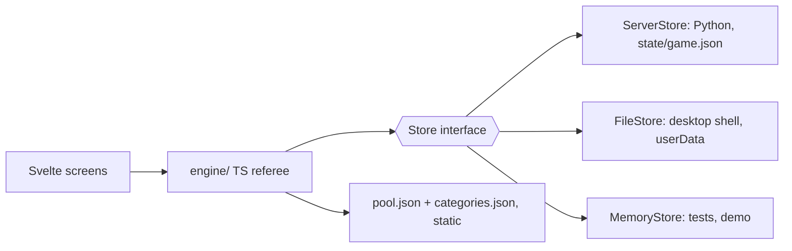

# 12 — Client Engine (Python → TypeScript)

**Status:** draft

Milestone M7 in [`project.md`](project.md); the Steam plan ([11](11-steam.md)) builds on it. It moves the game referee from the Python server into TypeScript, so the game runs without Python: in the browser, in a desktop shell ([18](18-steam-integration.md)), on the Steam Deck. **The rules don't change and the family's saves are kept.** This is a pure engineering change and can start now.

## Today
- `app/server/game.py` (~550 lines): players, games (the state as JSON), burning per player and for everyone, draw, pick, answer, skip, undo, jokers (D-25..D-28).
- `app/server/selection.py` (~130 lines): supply check and draw via exact bipartite matching (GF-2).
- `app/server/categories.py`: loads `app/data/categories.json`.
- `app/server/main.py`: the `/api/game/*` and `/api/players*` routes, and also the authoring API (review tool, stats, media).
- State: `state/game.sqlite` (players, games, burned).
- The server is the referee: the client never sees the correct answer or unrevealed hints before they are played (D-25).

## Target

- **`app/client/src/engine/`**: a pure TypeScript module with no DOM and no Svelte. It covers `selection.ts` (matching, supply), `game.ts` (state machine, jokers, burning, undo), `pool.ts` (loading and filtering), `rng.ts` (a seedable PRNG). Every function takes the state and returns the new state, so undo and saves stay simple.
- **Engine runs under plain Node 22** (D-60): erasable TS only (no `enum`, `namespace`, parameter properties), relative imports with `.ts` extensions, no Vite-only imports. tsconfig: `erasableSyntaxOnly`, `allowImportingTsExtensions`. Authoring calls it via `node` for the supply check.
- **Store interface**: `load(): SaveData` / `save(SaveData)`. `SaveData` is one versioned JSON document (`{version, players, games, burned}`) that replaces the SQLite tables. The data is small (players × burned IDs), so one document fits easily, and it suits Steam Cloud (one file) too.
- **`ServerStore`** (current game, until the Steam build replaces it, D-59): the Python server keeps a tiny `GET/PUT /api/save` that writes `state/game.json` atomically. No localStorage: D-3 rejected it as fragile.
- **Pool export** (done, D-35): `qgen export` writes the playable pool (`approved` only, without `review`, `quality` and pipeline fields) to `app/data/pool.json`. The TS engine loads that file; with locales (15b) it becomes one file per locale.
- **Data in the client** (pm plan 50, PORT-7): the server serves `app/data/` read-only at `/data/…`; the client loads pool and categories once per page load (reload after `qgen export`). `lib/api.ts` keeps its signatures and calls the engine + `ServerStore`.
- **Python game server after the port** (pm decision 4, D-59): static files plus `/api/save` only. Flags go into `SaveData`, categories are static files from `qgen export`, media is served from the synced cache only (no download on miss). The authoring API (review, stats, media fetch) stays in `trivia-authoring`. `app/server/game.py` and the game routes are deleted once parity holds.

## The referee question (needs a decision)
With the engine in the client, the correct answer is in memory before the players answer. For an offline single-player game that is acceptable: anyone who opens devtools to cheat at family trivia only spoils their own game. This relaxes D-25 ("the client never learns the correct answer"). The UI still must never *render* hidden data. Record it as a decision when PORT-3 lands.

## Parity strategy
1. **Fixtures first (PORT-1):** before porting, write a scenario recorder for the Python engine. It plays scripted games (picks, answers, every joker, skip, burn for everyone, undo, supply failures) on a small fixed pool and stores the inputs and outputs as JSON in `app/client/src/engine/fixtures/`. Randomness is a recorded shuffle tape, not a shared PRNG (D-58): every `random.shuffle` is logged as `{site, n, perm}`; the TS engine takes an injected `Rng`, and tests replay the tape. Format: `fixtures/README.md`.
2. **Port module by module:** `selection` first (pure, easy to compare), then `game`.
3. **Fixture tests:** the TS engine replays every fixture and must produce the same states. Tests use Node's built-in `node:test` (no new dependency).
   - Errors (D-57): PORT-3 throws the same codes as `game.py` (`GameError(code, params)`); parity compares `error`/`params`, not `message`. Joker `reason`s too.
4. **Invariant tests:** for random seeds on the real pool, check that every level gets 4 cards, burned questions never come back, and an available joker never breaks the supply.

## Migration
- `app/server/main.py` migrates `state/game.sqlite` to `state/game.json` once on start (players, burns per player and for everyone, the running game). The `.sqlite` file is kept as a backup.
- Lands in pm plan 49 (`app/server/save.py` `migrate()`), but `main.py` only calls it from PORT-7's switch-over change; before that `game.py` still writes `game.sqlite` and an early `game.json` would go stale.
- `SaveData.version` makes later migrations possible (game modes in 13, multiple locales in 15).

## Tasks
- [x] PORT-1 Scenario recorder for `app/server/game.py` + `app/server/selection.py`; commit the fixtures. Done 2026-10-11 (plan 18): `authoring/tools/record_fixtures.py` (`--check`), fixtures + README in `app/client/src/engine/fixtures/`.
- [ ] PORT-2 `engine/selection.ts`: supply check and draw (GF-2, D-25), fixture-tested.
- [ ] PORT-3 `engine/game.ts`: state machine, players, burning, jokers, undo. Decision: the client holds the answer (relaxes D-25).
- [ ] PORT-4 Store interface; `ServerStore` + Python `GET/PUT /api/save` (atomic write, with a retry for Windows file locks); `MemoryStore` for tests.
- [ ] PORT-5 Migration `game.sqlite` → `game.json`, tested on a copy of the family's real save.
- [x] PORT-6 `qgen.py export`: the playable pool for the client; `validate` checks that the export is current. *2026-10-07, pulled forward as LP-3 (`19-repo-layout.md`): `app/data/pool.json`; the Python game server reads it too.*
- [ ] PORT-7 Switch the screens from `lib/api.ts` game calls to the engine. Family test night on the TS engine.
- [ ] PORT-8 Delete `app/server/game.py` and the game routes; `app/server/selection.py` goes too: `qgen report` and `authoring/server/overview.py` get the supply from the TS engine via `node` (D-60, pm decision 5). Update `01-architecture.md` and AGENTS.md.
